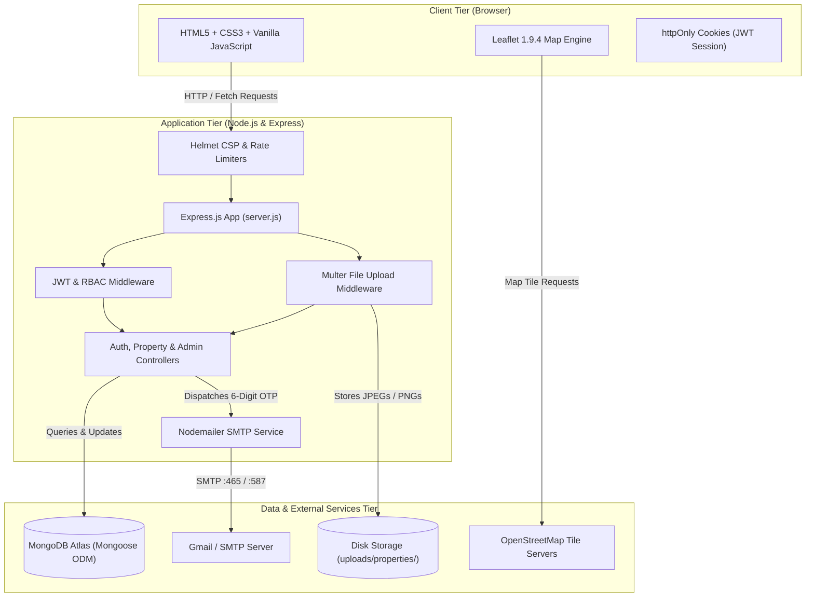
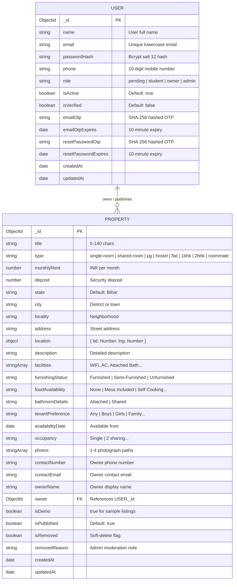
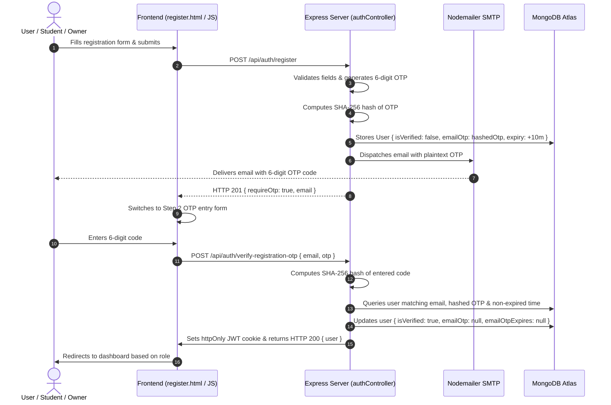

# Room Finder — Architecture, Design & Data Flow Specification

This document details the system design, database models, security architecture, and REST API specification for **Room Finder Bihar**.

---

## 1. High-Level System Architecture

---

## 2. Database Entity-Relationship Diagram (ERD)

---

## 3. Email OTP Verification Sequence

---

## 4. REST API Specification

| Endpoint | Method | Access | Description |
|---|---|---|---|
| `/api/auth/register` | `POST` | Public (Rate-limited) | Validates input, creates unverified user, sends 6-digit OTP |
| `/api/auth/verify-registration-otp` | `POST` | Public (Rate-limited) | Verifies 6-digit OTP, activates account, issues JWT cookie |
| `/api/auth/resend-registration-otp` | `POST` | Public (Rate-limited) | Resends fresh 6-digit OTP code |
| `/api/auth/login` | `POST` | Public (Rate-limited) | Verifies email & password; sets httpOnly JWT cookie |
| `/api/auth/logout` | `POST` | Authenticated | Clears JWT session cookie |
| `/api/auth/me` | `GET` | Optional Auth | Returns current authenticated user profile |
| `/api/auth/select-role` | `POST` | Authenticated | Updates user role between student and owner |
| `/api/auth/profile` | `PUT` | Authenticated | Updates name and phone number |
| `/api/auth/forgot-password` | `POST` | Public (Rate-limited) | Sends 6-digit password reset OTP to user email |
| `/api/auth/reset-password` | `POST` | Public (Rate-limited) | Verifies OTP and updates user password |
| `/api/properties` | `GET` | Public | Search listings with filters (city, locality, type, rent, sort) |
| `/api/properties/:id` | `GET` | Public | Returns comprehensive details of a listing |
| `/api/properties/mine` | `GET` | Owner only | Returns listings owned by current authenticated owner |
| `/api/properties` | `POST` | Owner only | Creates a new property listing with 1-4 photo uploads |
| `/api/properties/:id` | `PUT` | Owner only | Updates owner's listing and photos |
| `/api/properties/:id` | `DELETE` | Owner only | Deletes owner's listing and unlinks photos from disk |
| `/api/meta/locations` | `GET` | Public | Returns popular Bihar cities and localities |
| `/api/meta/options` | `GET` | Public | Returns room types, amenities, and specification enums |
| `/api/admin/login` | `POST` | Public (Rate-limited) | Dedicated administrator authentication |
| `/api/admin/stats` | `GET` | Admin only | Dashboard metrics (total users, owners, listings, removed) |
| `/api/admin/users` | `GET` | Admin only | Returns registered user accounts |
| `/api/admin/users/:id/active`| `PATCH` | Admin only | Deactivates or reactivates a user account |
| `/api/admin/listings` | `GET` | Admin only | Returns all listings including removed items |
| `/api/admin/listings/:id/remove` | `POST` | Admin only | Moderates / takes down a listing with a reason |
| `/api/admin/listings/:id/restore`| `POST` | Admin only | Restores a moderated listing |
| `/api/admin/listings/:id` | `DELETE` | Admin only | Permanently deletes a listing and its files |

---

## 5. Role-Based Access Control Matrix

| Feature / Action | Visitor | Student / Tenant | Property Owner | Administrator |
|---|:---:|:---:|:---:|:---:|
| Search & Browse Listings | Yes | Yes | Yes | Yes |
| View Room Details & Map | Yes | Yes | Yes | Yes |
| Copy Owner Contact Number | Yes | Yes | Yes | Yes |
| Account Registration & Login | Yes | Yes | Yes | Dedicated |
| Update Profile & Mobile Number | No | Yes | Yes | No |
| Post New Property Listings | No | No | Yes | No |
| Edit / Delete Own Listings | No | No | Yes | No |
| Moderate Any Listing | No | No | No | Yes |
| Deactivate User Accounts | No | No | No | Yes |
| View System Dashboard Metrics | No | No | No | Yes |
