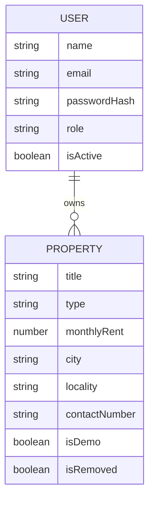
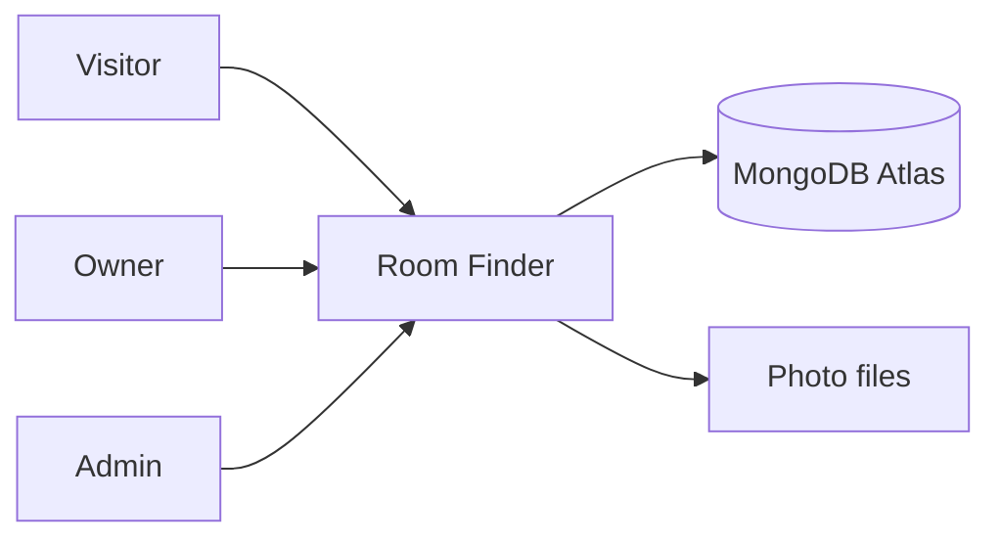
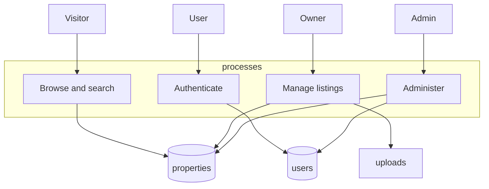
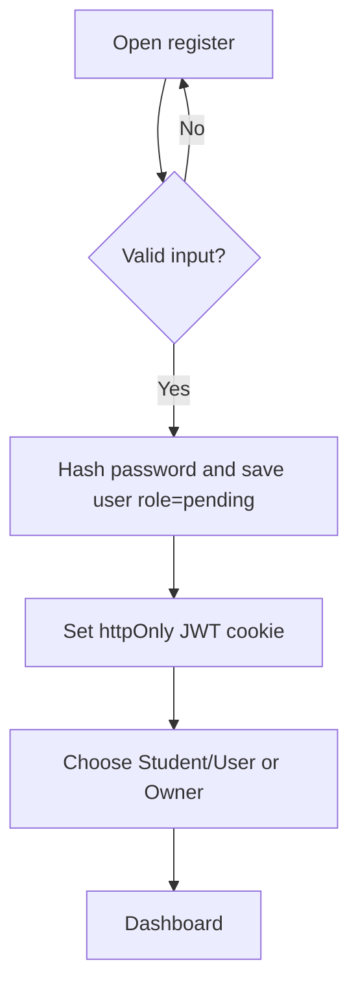
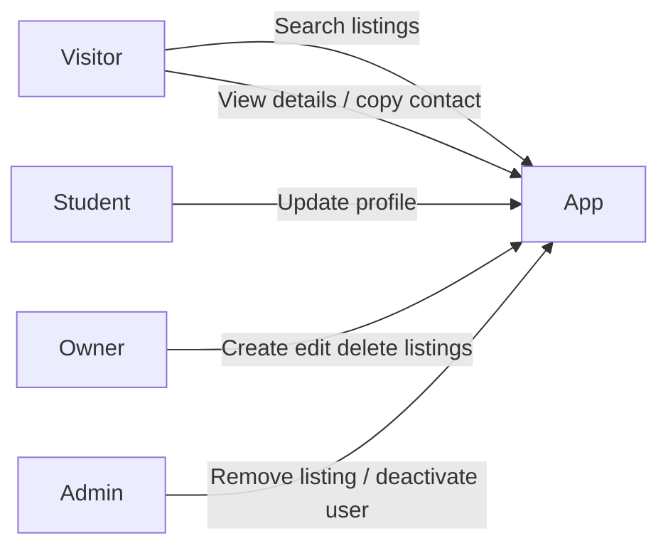

# Room Finder

**A web application for discovering rental accommodation in Bihar**

Diploma in Computer Science and Engineering — Minor Project Report

(This Markdown file can be copied into Microsoft Word. Keep headings, then Insert → Pictures for screenshots you capture on your computer.)

---

## 1. Abstract

Room Finder is a full-stack web application that helps people browse rental rooms, paying-guest (PG) accommodation, hostels, and flats in Bihar. Public visitors can search by city or locality and by monthly rent, open a listing, and copy the owner’s contact number without creating an account. Registered users choose whether they are a student/user or a property owner. Owners can publish listings with one to four photographs. Administrators use a separate login to remove inappropriate listings and deactivate accounts.

The system is implemented with HTML, CSS, and JavaScript on the client, Node.js with Express on the server, and MongoDB Atlas for data. Passwords are hashed with bcrypt. Login uses a JSON Web Token stored in an httpOnly cookie. Sample listings are clearly marked so that demonstration data is never presented as verified real property.

## 2. Introduction

Finding a room in a new city is often done through informal networks and unverified social-media posts. Students and other tenants need a simple website where they can filter by location and budget. Property owners need a way to publish a listing without a heavy framework. This project implements a small, understandable system suitable for a diploma submission, with attention to validation, authorisation, and honest labelling of sample data.

The application is designed around Bihar. City and locality are stored as ordinary text, so any town in the state can be added later without changing the database schema. The seed data includes Patna and other major cities for demonstration only.

## 3. Problem statement

People looking for rental accommodation in Bihar lack a simple, role-based website that supports:

- browsing without mandatory registration
- search by location and rent
- owner-managed listings with photos and a contact number
- an administrator who can take down inappropriate content

Social posts do not provide structured search, and many student projects either skip security or mix invented “real” listings with no disclaimer.

## 4. Objectives

1. Provide a responsive public website to search and view listings.
2. Allow email/password registration with a post-login role choice (student/user or owner).
3. Let owners create, edit, and delete only their own listings.
4. Store listing metadata in MongoDB and photos as files (not as huge documents).
5. Protect administrator functions on the server.
6. Use hashed passwords, environment variables for secrets, and basic rate limiting on login.
7. Document setup, limitations, and tests honestly.

## 5. Scope of the proposed system

**In scope**

- Public home, browse, and details pages
- Registration, login, logout, role selection, profile update
- Owner listing CRUD with 1–4 photos
- Admin login, listing removal/restore, user deactivate/reactivate
- Location + min/max rent search
- Copy contact number
- Sample/demo seed data labelled as SAMPLE

**Out of scope (this version)**

- Favourites, reviews, ratings
- Online payments, OTP, in-app chat
- Interactive maps
- Email-based forgot-password (no free mail service is configured)
- Claiming verified vacancies across all of Bihar

## 6. Hardware and software requirements

**Hardware (development)**

- Personal computer with at least 4 GB RAM
- Internet connection (for Atlas and npm)

**Software**

- Windows 10/11 (also runs on macOS/Linux)
- Node.js 18 or later
- Web browser
- MongoDB Atlas account (free cluster)
- Optional: Git, Visual Studio Code / Cursor

## 7. Technology stack

| Layer | Choice | Reason |
| --- | --- | --- |
| Frontend | HTML5, CSS3, vanilla JS | Beginner-friendly, no React build step |
| Backend | Node.js, Express.js | Standard for small REST APIs |
| Database | MongoDB Atlas + Mongoose | Cloud hosted, flexible documents |
| Auth | bcryptjs, jsonwebtoken, httpOnly cookie | Hashing + session without localStorage tokens |
| Uploads | multer, local disk | Simple for a student project |
| Security extras | helmet, express-rate-limit | Headers and auth throttling |

## 8. System architecture

The browser loads static pages from Express. JavaScript calls JSON APIs on the same origin. Express validates input, checks the JWT cookie, reads/writes MongoDB, and stores images under `uploads/properties`.

```
[Browser: HTML/CSS/JS]
        |  HTTP + cookie
[Express server]
        |                 \
   [MongoDB Atlas]     [uploads/ folder]
```

**Modules**

- **Public module:** home, search, listing details, copy contact
- **Account module:** register, login, role, profile
- **Owner module:** listing form and dashboard
- **Admin module:** separate login, users, listings
- **Meta module:** Bihar city hints and room-type options

## 9. Functional requirements

| ID | Requirement | Status in code |
| --- | --- | --- |
| F1 | Browse listings without login | Implemented |
| F2 | Search by city/locality and rent | Implemented |
| F3 | View details including photos and contact | Implemented |
| F4 | Copy contact number with message | Implemented |
| F5 | Register and log in with hashed password | Implemented |
| F6 | Choose student/user or owner after login | Implemented |
| F7 | Student/user updates name and phone | Implemented |
| F8 | Owner CRUD on own listings only | Implemented |
| F9 | 1–4 photos, type/size checks on server | Implemented |
| F10 | Publish immediately | Implemented |
| F11 | Admin review/remove listings | Implemented |
| F12 | Admin deactivate users | Implemented |
| F13 | No public admin registration | Implemented |

## 10. Non-functional requirements

- Responsive layout (CSS media queries)
- Understandable validation messages
- Secrets in environment variables
- Passwords never logged or returned in JSON
- Basic rate limits on authentication
- Empty, loading, and error states on listing views

## 11. Database design

### Collection: users

| Field | Type | Notes |
| --- | --- | --- |
| name | String | Required |
| email | String | Unique, lowercase |
| passwordHash | String | bcrypt, not selected by default |
| phone | String | Optional 10-digit Indian mobile |
| role | String | pending, student, owner, admin |
| isActive | Boolean | Admin can set false |
| createdAt, updatedAt | Date | Mongoose timestamps |

### Collection: properties

| Field | Type | Notes |
| --- | --- | --- |
| title | String | 5–120 chars |
| type | String | single-room, shared-room, pg, hostel, flat, other |
| monthlyRent | Number | 500–500000 |
| deposit | Number | Optional |
| state | String | Default “Bihar” |
| city, locality | String | Free text — any Bihar place |
| address | String | Optional |
| description | String | 20–2000 chars |
| facilities | String[] | From a fixed allowed list |
| occupancy | String | Optional |
| photos | String[] | 1–4 URL paths |
| contactNumber | String | 10-digit |
| owner | ObjectId | Ref users |
| isDemo | Boolean | Seed data flag |
| isRemoved | Boolean | Admin hide |
| removedReason | String | Optional |
| createdAt, updatedAt | Date | |

City/locality are **not** a separate collection so new towns do not need a schema migration.

## 12. Diagrams

Copy each Mermaid block into Word as a figure, or redraw in Draw.io.

### 12.1 Entity relationship (logical)



### 12.2 DFD Level 0



### 12.3 DFD Level 1



### 12.4 Registration and role flowchart



### 12.5 Use cases



## 13. API endpoints

See `docs/API.md` for the full table. Summary:

- Public property list/detail and meta options
- `/api/auth/*` for register, login, logout, me, select-role, profile
- Owner property create/update/delete
- `/api/admin/*` protected except login

## 14. Implementation details

**Frontend.** Static pages in `public/` share `css/styles.css`. `js/api.js` wraps `fetch`. Navigation loads `/api/auth/me` to switch login/logout links.

**Backend.** `server.js` applies Helmet, JSON parsing, cookie parser, static files, then mounts routers. Errors return JSON for `/api` paths.

**Authentication.** `src/middleware/auth.js` signs a 7-day JWT (`sub`, `role`) and sets cookie `rf_token` with httpOnly and SameSite=Lax. Admin users cannot use the public login route.

**Authorisation.** Owner update/delete compares `property.owner` with `req.user._id`. Admin routes use `requireRole("admin")`.

**Uploads.** Multer accepts JPEG/PNG/WEBP, maximum 2 MB and 4 files. Random file names are stored. Seed photos are SVG files in `public/images/demo/`.

**Search.** Optional regex on city and/or locality (escaped), plus rent range. A single homepage location box matches city **or** locality.

**Forgot password.** Not implemented. A reliable reset link needs a mail provider (for example a verified SMTP or transactional email API). This is listed under limitations rather than faked.

**Maps.** Not implemented. Details pages show locality, city, state, and optional address.

## 15. Test cases and results

Automated CI was not part of this submission. Manual cases are listed in `docs/TEST_PLAN.md`.

**Do not paste invented pass/fail screenshots.** After you run each case on your PC, fill the result column in Word.

Development-time checks (syntax/install) are recorded in the chat that delivered this code, not as a substitute for your viva demonstration.

## 16. Screenshots checklist (capture yourself)

1. Home page (desktop)
2. Home page (mobile width)
3. Browse results with SAMPLE badge
4. Listing details and copy-contact success message
5. Register and role selection
6. Owner add-listing form
7. Owner dashboard
8. Admin login and admin dashboard
9. Validation error (short password or missing photo)
10. Empty search result

## 17. Limitations

1. No email password reset.
2. No map.
3. Photos on local disk are not ideal for all cloud hosts.
4. Seed listings are fictional samples; the app does not verify real vacancies in Bihar.
5. Role cannot be switched after it is set (except by database/admin work).
6. JWT in a cookie is convenient for same-origin pages; CSRF is reduced with SameSite=Lax but not a full anti-CSRF token design.
7. Rate limiting is in-memory per process (fine for one student server).

## 18. Future scope

- Email OTP / password reset with a real mailer
- Persistent object storage for images
- Optional map once a free, testable provider is chosen
- Moderation queue before publish (currently publish-immediately, as specified)
- More Bihar cities in the UI helper list (schema already allows any city)

## 19. Conclusion

Room Finder demonstrates a complete, understandable rental-listing workflow for a diploma project: public search, authenticated roles, owner CRUD, admin controls, and explicit sample data. The design keeps dependencies small and documents what was not built.

## 20. References

1. Express.js documentation, https://expressjs.com/
2. Mongoose documentation, https://mongoosejs.com/
3. MongoDB Atlas documentation, https://www.mongodb.com/docs/atlas/
4. OWASP Authentication Cheat Sheet, https://cheatsheetseries.owasp.org/
5. MDN Web Docs — HTML, CSS, Fetch API
6. bcryptjs and jsonwebtoken package documentation

## 21. Installation and run instructions

Follow the root `README.md`. Short form:

```text
copy .env.example .env
(edit .env — Atlas URI, JWT_SECRET, admin credentials)
npm install
npm run create-admin
npm run seed
npm start
```

Open http://localhost:3000
